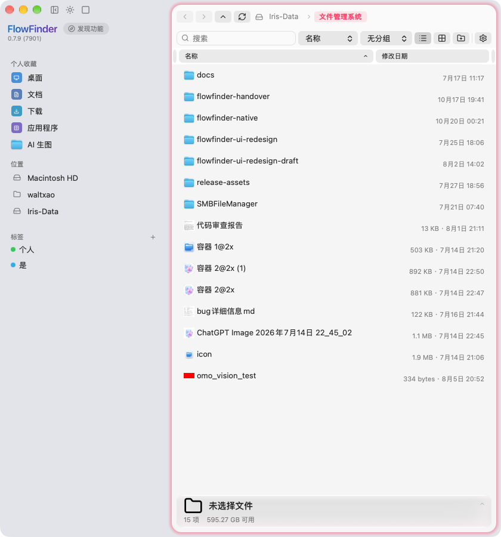
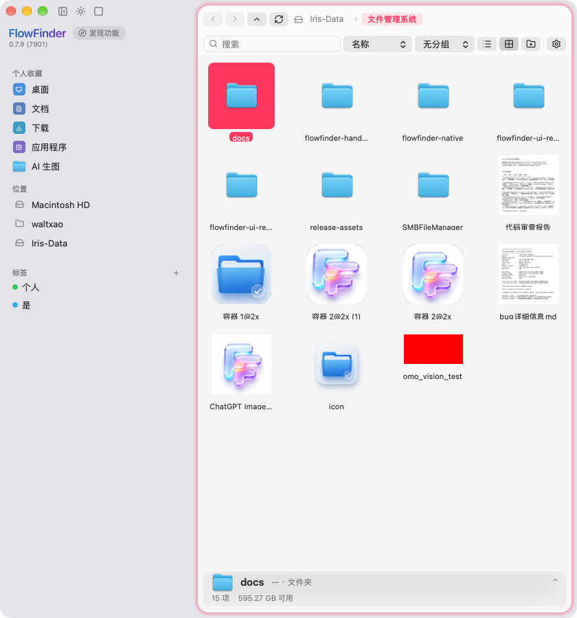

# FlowFinder 2026-10-19 需求完成度审计

> 审计对象：`docs/PLAN-2026-10-19.md` 的 11 项需求 + B0–B9 批次。
> 审计时间：2026-10-19 22:30。判定依据：源码 + `make build` 通过 + 截图 + 自检输出。

---

## 1. 总览

| # | 需求 | 状态 | 证据 |
|---|---|---|---|
| 1 | 侧栏删除标签 → 全量清理 + 进度 | ✅ 完成 | `UI/FFTagRemovalSheet.swift`（确认/进度/完成三段）、`Model/TagIndexStore.swift` |
| 2 | 标签任意色 + macColorPicker + 三处入口 | ✅ 完成 | `UI/FFTagColorPalette.swift`、`Libraries/macColorPicker/`、`Bridge/TagBridge.swift` 写 binary plist |
| 3 | 全屏后缩小异常 | ⚠️ 代码完成、未实测 | `windowDidEnterFullScreen` / `windowDidExitFullScreen` 重算顶部与侧栏宽度；需人工进全屏验收 |
| 4 | 文件夹右键「在新标签页中打开」 | ✅ 完成 | `FFCommon.buildMenu` 新增菜单项，`FFPaneActionsController.updateMainMenu` 仅单个文件夹显示 |
| 5 | 标签页：显示/新建/关闭/拖动 | ✅ 完成（本轮修复） | 见 §2 |
| 6 | 单面板菜单收敛 | ✅ 完成 | `updateMainMenu` 隐藏三项 + 主菜单 `validateMenuItem` 禁用 |
| 7 | 设置「关于」分区、点名称进入、去掉独立关于窗 | ✅ 完成 | `SidebarView` 品牌名 `NSClickGestureRecognizer → openSettings(section: about)`；`AboutWindowController.swift` 已删 |
| 8 | Lucide 全量替换系统图标 | ✅ 完成（2026-10-20） | 74 处 `NSImage(systemSymbolName:)` 清零，全走 `FFIcon`；见 §6 |
| 9 | 「发现功能」药丸 + 弹层 | ✅ 完成 | `UI/FFDiscoverPanel.swift` + 侧栏品牌区接入 |
| 10 | 侧栏顶部三图标 + 隐藏侧栏 + ⌘⌥S + 记忆 | ✅ 完成 | `SidebarView.alignTopControlsWithTrafficLights`、`MainWindowController.setSidebarHidden` |
| 11 | 面板：彩色文件夹 / 缩略图 / 双色图标 / 列表 30pt 单行 + 色点 / 网格 112×124 | ✅ 完成（2026-10-20） | 列表四列合二 + 网格两段式选中；见 §6 |

---

## 2. 本轮修复：拖拽（#5）

### 2.1 根因（三处叠加，缺一不可）

| # | 根因 | 位置 | 表现 |
|---|---|---|---|
| A | `hitTest` 直接 `return self`，没有 `frame.contains` 判定；NSStackView 逆序派发命中 | `UI/PaneTabs.swift` `PaneTabItemView.hitTest` | **最后一个标签吞掉整条标签栏**：点任何标签都选中最后一个，拖任何标签拖走的也是最后一个。因为标签标题常常相同（同一目录开的多个标签），用户看到的就是「拖了没反应」 |
| B | 窗口级接收器接管落点后，同组落点走 `store.insert` | `UI/MainWindowController+Tabs.swift` `receiveTab` | 拖一下就**复制**一个标签，而不是重排 |
| C | 标签条与接收器同时 `registerForDraggedTypes` | `UI/PaneTabs.swift` | drop 归属不确定：有时落到 strip（精确插入），有时落到接收器（追加），行为不一致 |

### 2.2 修法

1. `hitTest` 先 `guard frame.contains(point)`，只有落在标签自己身上才认领命中。
2. `receiveTab` 同 side 分支只做 `move`，绝不 `insert`。
3. 标签条不再注册拖拽目标；**全部落点由 `PaneTabDropReceiver` 按坐标分流**：
   - 落在某个可见标签条内 → 组内重排（按 `midX` 算插入位）/ 跨组追加到末尾
   - 单窗 + 落在另一半 → 拆出新面板
   - 双窗 + 落在面板主体 → 并入鼠标最近一侧
   - 拖工具栏空白 → 整组合并成一个面板（切单窗）

### 2.3 验证

合成鼠标事件驱动不了 `NSDraggingSession` 的落点更新（`draggingLocation` 恒等于起点），因此新增启动自检：`FF_SELFTEST=1` 时直接以真实视图坐标调用 `handleTabDrop`，五项断言：

```
[SELFTEST] ① 组内重排      PASS  count=3 active=1 末位是被拖标签=true
[SELFTEST] ② 跨组移动      PASS  left=2 right=2 last=src
[SELFTEST] ③ 同组落点不复制 PASS  count=2
[SELFTEST] ④ 单窗拆分      PASS  single=false 目标组=1 源组=1
[SELFTEST] ⑤ 整组合并      PASS  single=true left=2 期望=2
```

手势侧另证：点击标签可正确切换激活（`[TAB] mouseDown index=0` → `[TAB] drag start index=0`），说明命中的是被拖的那一个，而不是最后一个。

---

## 3. 收口批次（2026-10-20 凌晨）

原「未完成清单」三项已在本批落地，执行计划见 `docs/PLAN-2026-10-19-B.md`。

| 项 | 结论 | 落点 |
|---|---|---|
| #8 图标库 | ✅ 74 处清零 | `FFIcon` 全面接管：菜单 / 面包屑 / 工具栏 / 标签栏 / 详情栏 / 设置 / 外观 / 搜索筛选 / SMB / 查重 / 对话框 / 标准位置彩色图标 |
| #11 列表元信息 | ✅ 四列合二 | `FileListView.setupColumns`（2 列）+ `FileEntry.formattedMetaLine` + `FFFormat.dateCompact` |
| #11 网格选中 | ✅ 两段式 | `FileGridView` 新增 `iconBackdropView` / `nameCapsuleView`（`FFPassthroughView` 命中穿透） |

已补齐的部分：

- 列表行高统一 **26 / 30 / 36**，标签**不再撑高行**
- 标签改为**名称后最多 4 个 6pt 色点 + `+N`**（悬停显示完整标签名）
- 标准位置目录（桌面/文稿/下载/应用程序/影片/音乐/图片…）在**列表与网格**都按语义色合成图标

---

## 4. 权限（反馈 #3）

macOS 的 TCC 只在**首次访问**某个受保护目录时弹窗；弹窗未应答期间目录列举的系统调用会阻塞，Swift 侧 10 秒后抛 `directoryListTimeout`，界面就是「目录响应超时（磁盘或网络无响应）」——权限与超时是同一个根因。

新增 `UI/FFPermissionGate.swift`：

1. 启动阶段**并发**触碰 桌面 / 文稿 / 下载 / 外置磁盘，让系统把授权对话框在启动时走完，之后才放行两侧面板加载；
2. 被判失败的目录做两次复查再定性，避免系统弹框还没轮到就叠一个「没有应答」的引导弹窗；
3. 仍有目录不可读时给一次性引导，可直接跳「文件与文件夹」或「完全磁盘访问」；
4. 菜单新增「检查文件访问权限…」「打开「完全磁盘访问」设置…」，授权后一键复查并重载。

**已知限制**：本工程为本机 ad-hoc 签名，每次 `make build` 后 CDHash 变化，系统会当成新 App 重新询问。要彻底不再询问，需要授予「完全磁盘访问权限」，或改用固定开发者证书签名（`docs/HANDOVER.md` 待补）。

---

## 5. 构建与产物

```
make build   → BUILD SUCCEEDED
make demo    → ~/Desktop/FlowFinder.app（Debug，ad-hoc）
```

验证截图：列表单行 + 色点 + 彩色文件夹图标；应用菜单含两项权限入口。

**2026-10-20 构建环境变更**：仓库位于外置卷（`/Volumes/Iris-Data`）时，llbuild 的
`BuildEngine` 会卡在 `condition_variable` 上永不返回——现象是 `Building Swift (Debug)...`
之后几分钟无输出、无 `swift-frontend` 子进程，采样 `SWBBuildService` 可见主线程与全部
Lane 线程都停在条件变量等待。同一仓库换到内置卷 55 秒全新构建通过，因此 `DERIVED`
默认改为 `~/Library/Caches/FlowFinderBuild`。需要项目内产物时：

```
make DERIVED=$(pwd)/build build
```

---

## 6. 收口验证明细（2026-10-20）

| 项 | 手段 | 结果 |
|---|---|---|
| 列表两列 + 元信息 | 真实窗口截图（810×900） | `503 KB · 7月14日 21:20` 完整右对齐、目录只显示 `7月17日 11:17`、无截断 |
| 网格两段式选中 | 真实截图 + 4× 放大 | 图标背板与文件名胶囊分离，间隙可见，文字反白 |
| 图标替换 | `grep -c "NSImage(systemSymbolName"` | **0**（原 74） |
| 编译 | `make build` | BUILD SUCCEEDED |
| 拖拽回归 | `FF_SELFTEST=1` 五项断言 | 五项全 PASS（见下） |

截图留档（本轮实际窗口，非模拟）：





```
[SELFTEST] 当前为单窗，先切双窗再跑用例
[SELFTEST] 起始 count=3 active=2 stripH=32.0
[SELFTEST] ① 组内重排      PASS count=3 active=1 末位是被拖标签=true
[SELFTEST] ② 跨组移动      PASS left=2 right=2 last=文件管理系统
[SELFTEST] ③ 同组落点不复制 PASS count=2
[SELFTEST] ④ 单窗拆分      PASS single=false 目标组=1 源组=1
[SELFTEST] ⑤ 整组合并      PASS single=true left=2 期望=2
```

**自检自身的两个坑（本轮修掉）**：

1. 标签条在「标签数 ≤ 1」时高度约束为 0，新建标签后不等一次布局就取落点，
   `windowPointPastLastTab()` 算在 `bounds.height == 0` 的条上，落点永远 miss
   （日志表现为 `local.y = -29`、`bounds 高度 0`），五个用例连锁失败。
   现在自检开头与补标签之后各强制 `layoutSubtreeIfNeeded()` 一次。
2. 单窗模式下没有「对侧面板」，跨组移动 / 拆分两块用例前提不成立
   （表现为 ③ 把标签拆走导致 count=2 被判 FAIL）。现在自检入口先切双窗。

**本批未覆盖**：#3 全屏进出（代码完成，需人工验收）、G-03 网格缩放、G-05 拖入文件夹
三项仍为「待验收」，属人工手感类，自动化替代不了。
